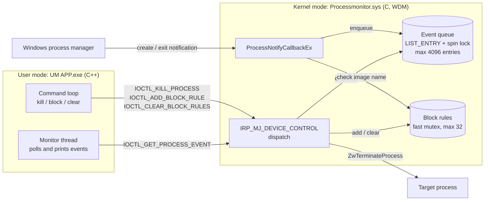

# Process Monitor

A Windows **kernel-mode driver** (C, WDM) paired with a **user-mode console client** (C++) that monitors process creation and termination system-wide in real time, terminates processes from kernel mode, and blocks selected executables from launching.

Example session (lines without a `[...]` tag are typed commands):

```
=== PROCESS MONITOR ===
Connected successfully!
[CREATE] 2026-06-26 14:39:25.102 | PID: 8124 | PPID: 5520 | CommandLine: "C:\Windows\system32\notepad.exe"
[EXIT  ] 2026-06-26 14:39:31.877 | PID: 8124
block notepad.exe
OK: block notepad.exe
[BLOCK ] 2026-06-26 14:39:40.415 | PID: 9032 | PPID: 5520 | CommandLine: "C:\Windows\system32\notepad.exe"
kill 7710
OK: kill process 7710
```

## Features

- **Real-time process monitoring** – a `PsSetCreateProcessNotifyRoutineEx` callback captures every process creation and exit, with timestamp, PID, parent PID and command line.
- **Kernel-mode termination** – kills a process by PID through `ZwOpenProcess` / `ZwTerminateProcess`.
- **Launch blocking** – rejects new processes whose image file name matches a rule (case-insensitive) by setting `CreationStatus = STATUS_ACCESS_DENIED` inside the callback.
- **Secured device** – the control device is created with `IoCreateDeviceSecure` and an SDDL that only allows SYSTEM and Administrators to open it.
- **Bounded memory** – the event queue is capped at 4096 entries; if no client is reading, the oldest events are dropped so non-paged pool can't grow without limit.
- **Bitness-independent protocol** – the shared structures use fixed-width fields, so both the x64 and Win32 builds of the client work against the x64 driver.

## Architecture



The client talks to the driver through the symbolic link `\\.\ProcessMonitor` (`\Device\ProcessMonitor` in kernel mode).

| IOCTL | Direction | Payload |
|---|---|---|
| `IOCTL_GET_PROCESS_EVENT` | out | `PROCESS_EVENT` (0 bytes when the queue is empty) |
| `IOCTL_KILL_PROCESS` | in | `KILL_REQUEST { ULONG ProcessId }` |
| `IOCTL_ADD_BLOCK_RULE` | in | `BLOCK_RULE { WCHAR ImageName[64] }` |
| `IOCTL_CLEAR_BLOCK_RULES` | – | – |

All IOCTLs use `METHOD_BUFFERED`, and the driver validates every buffer length (and null-termination for block rules) before use.

## Project structure

```
Common/Shared.h                 IOCTL codes and structures shared by driver and client
Process monitor/                Kernel driver (Visual Studio solution)
  Process monitor/main.c        DriverEntry, IOCTL dispatch, process callback, block rules
UM APP/                         User-mode client (Visual Studio solution)
  UM APP/UM APP.cpp             Event reader thread and interactive command loop
```

## Requirements

- Windows 10 / 11 x64
- Visual Studio 2022 with the **Desktop development with C++** workload
- **Windows Driver Kit (WDK)** matching your SDK version
- A **virtual machine** for testing is strongly recommended – a kernel bug crashes the whole system.

## Build

1. Open `Process monitor/Process monitor.sln`, select **Release | x64**, build.
   Output: `Process monitor/x64/Release/Processmonitor.sys` (signed with the WDK test certificate).
2. Open `UM APP/UM APP.sln`, select **Release | x64**, build.
   Output: `UM APP/x64/Release/UM APP.exe` (statically linked CRT, so no redistributable is needed on the test machine).

## Run (on a test machine / VM)

The driver is test-signed, so Windows must be in test-signing mode (Secure Boot must be off):

```bat
bcdedit /set testsigning on
shutdown /r /t 0
```

Then, from an **elevated** command prompt:

```bat
sc create ProcessMonitor type= kernel binPath= C:\path\to\Processmonitor.sys
sc start ProcessMonitor
"UM APP.exe"
```

Client commands:

| Command | Action |
|---|---|
| `kill <pid>` | Terminate a process (decimal PID) |
| `block <name>` | Block new launches of an image file name, e.g. `block notepad.exe` |
| `clear` | Remove all block rules |
| `help` | Show the command list |
| `quit` | Exit the client |

Unload and clean up:

```bat
sc stop ProcessMonitor
sc delete ProcessMonitor
bcdedit /set testsigning off
```

Debug builds print diagnostic messages with `KdPrint`; view them with WinDbg or Sysinternals DebugView (enable *Capture Kernel*).

## Safety notes

- Kernel-mode termination bypasses user-mode protections. The driver refuses the Idle (0) and System (4) processes and the caller itself, but killing a critical process such as `csrss.exe` or `wininit.exe` **will bug-check (BSOD) the machine**.
- The block list matches on file name only (`notepad.exe`), not the full path, and holds at most 32 rules. Rules live in memory and are cleared when the driver unloads.

## Limitations and future work

- The client polls the driver every 100 ms when the queue is empty; an inverted-call model (pending IRPs completed by the callback) would remove the polling.
- Command lines longer than 255 characters are truncated.
- Possible extensions: thread and image-load callbacks (`PsSetCreateThreadNotifyRoutine`, `PsSetLoadImageNotifyRoutine`), full-path or hash-based block rules, and persisting rules in the registry.

## Disclaimer

This project is for learning and research on Windows internals. Only load the driver on machines you own and are allowed to modify.
